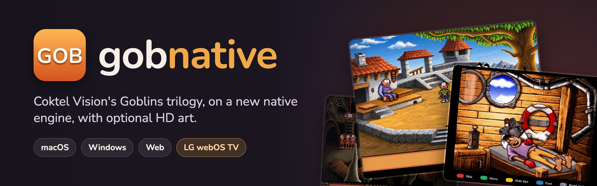
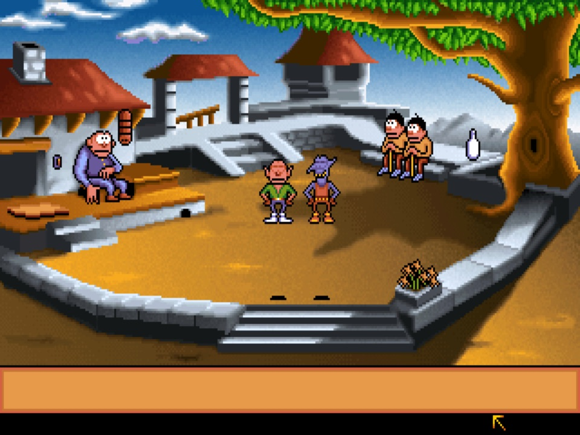
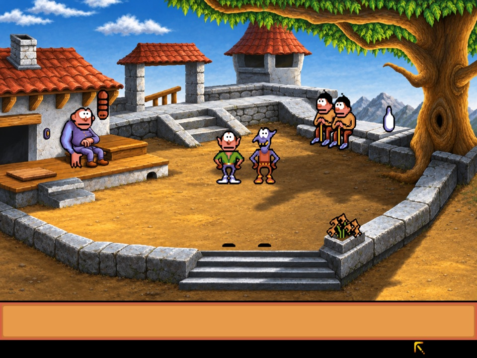
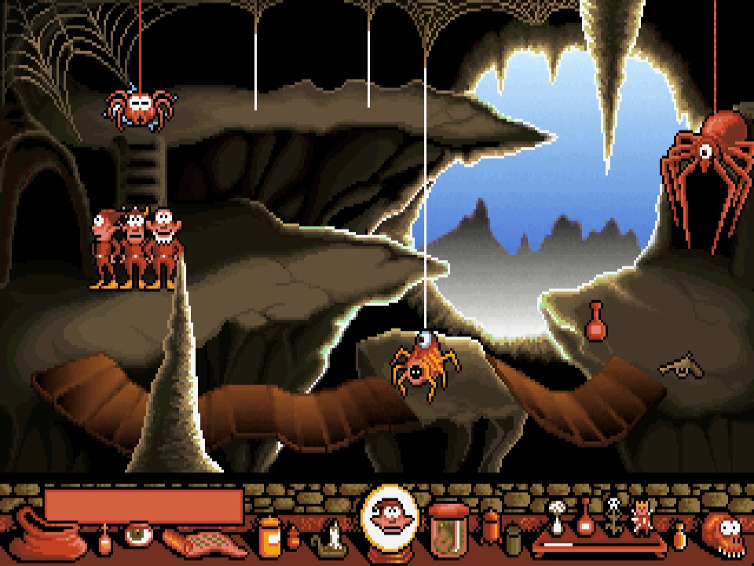
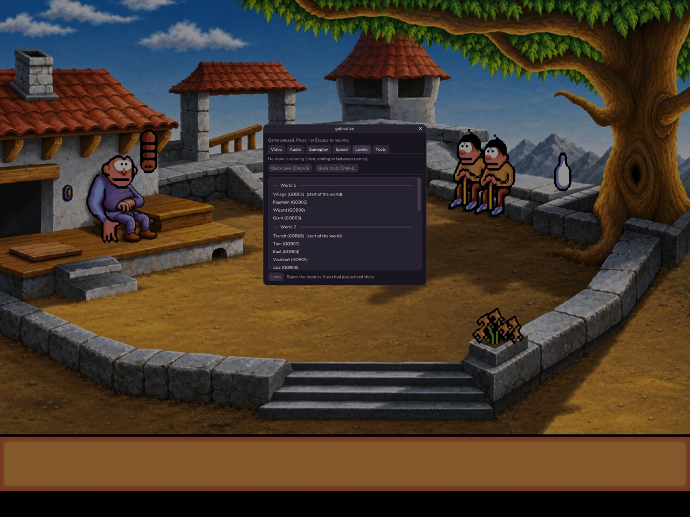
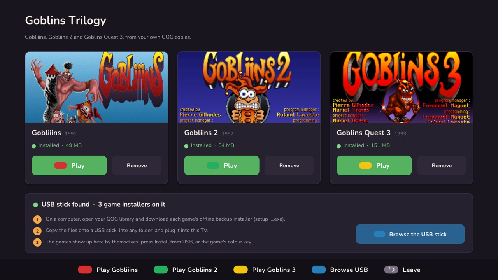
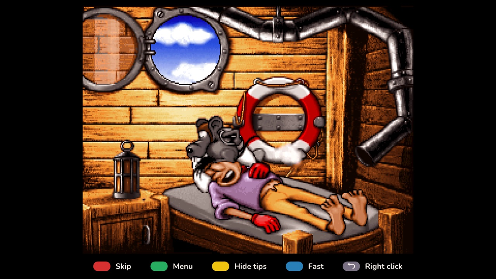

<p align="center">
  
</p>

<p align="center">
  <a href="https://games.encrypted-cat.com/other-projects/gobnative/"></a>
  <a href="https://github.com/initcore0/gobnative/actions/workflows/windows.yml"></a>
  <a href="LICENSE"></a>
  
  
</p>

# gobnative

**Play Coktel Vision's Goblins trilogy natively on macOS, Windows, LG webOS
TVs and in the browser, with optional HD remasters.**

gobnative is a from-scratch reimplementation of the Gob engine that ran
**Gobliiins** (1991), **Gobliins 2: The Prince Buffoon** (1992) and
**Goblins Quest 3** (1993). It's not an emulator and doesn't contain
ScummVM or DOSBox: the original game scripts run on a new C++20 engine,
written using [ScummVM](https://www.scummvm.org/)'s `gob` engine as the
reference for how the games behave. ScummVM already plays these games very
well; gobnative is a separate project that adds things on top.

> **Bring your own game.** No game data is included or distributed. You
> need the games, for example the CD versions from
> [GOG](https://www.gog.com/); gobnative installs them straight from the GOG
> installer.

## Screenshots

Gobliins 2's first room, as the game draws it and with an HD pack made by the
remaster scripts below:

<table>
  <tr>
    <td width="50%"></td>
    <td width="50%"></td>
  </tr>
  <tr>
    <td align="center"><sub>Original pixels (sharp bilinear filter)</sub></td>
    <td align="center"><sub>HD pack (room backgrounds; the goblins stay original)</sub></td>
  </tr>
</table>

<table>
  <tr>
    <td width="50%"></td>
    <td width="50%"></td>
  </tr>
  <tr>
    <td align="center"><sub>Gobliiins, the first level</sub></td>
    <td align="center"><sub>The in-game menu: level select, quick save, filters, HD packs</sub></td>
  </tr>
  <tr>
    <td width="50%"></td>
    <td width="50%"></td>
  </tr>
  <tr>
    <td align="center"><sub>On an LG TV: the library, games installed from a USB stick</sub></td>
    <td align="center"><sub>Goblins Quest 3 on the TV, with the remote's key tips</sub></td>
  </tr>
</table>

## What it adds

- **HD packs.** Replace any picture with a high-resolution version: rooms,
  title screens, sprites. They're drawn pixel-aligned with the original, can be
  switched live, and work for backgrounds only or sprites too, with filters for
  whatever stays original.
- **A remaster pipeline** to make your own HD packs (see below). The packs
  themselves are not shared, since they're made from the games' art.
- **Sharp HD text**, display filters (smooth, sharp bilinear, Scale2x/3x,
  xBR-like, CRT) and 4:3 aspect correction.
- **Enhanced sound effects** and replacement music.
- **An in-game overlay** (backquote key) for all settings:
  - **level select**, including Gobliiins' passwords and Goblins Quest 3's
    rooms in the state you reached them;
  - **quick save/load** in all three games (Gobliiins originally has none);
  - **1.2–2× speed** and turbo;
  - **skippable** intros and in-between scenes.
- **Hints for Gobliiins**, off unless you ask for them: press H (the yellow
  key on a TV, the Hint button on a touchscreen) for a nudge, again for who
  does what where (the spot glows), again for the solution. The hints follow
  the state of the level, so they keep up however you play, and they warn
  you when the original game has trapped you in a level you can no longer
  win. A "show clickable spots" glow works in all three games.
- **A game library** with one tile per game. Click a missing game, pick its
  GOG installer, and it's unpacked and installed (no external tools; files
  are checked against GOG's checksums).
- **Tools for modders:**
  - a disassembler;
  - a headless runner that plays click scripts;
  - picture, frame and room-guide export;
  - HD pack checks.

## Status

| | macOS | Windows | Web (WebAssembly) | LG TV (webOS) |
|---|---|---|---|---|
| Gobliiins | ✅ played through by hand | ✅ built and tested in CI | ✅ | ✅ on an LG C1 |
| Gobliins 2 | ✅ played through by hand | ✅ built and tested in CI | ✅ | ✅ on an LG C1 |
| Goblins Quest 3 (speech, video) | ✅ | ✅ built and tested in CI | ✅ | ✅ on an LG C1 |

**How it's tested:**
- All three games are played from the intro to the ending by automated
  click-script walkthroughs on every change.
- Gobliiins and Gobliins 2 have also been played through by a human (both
  on macOS, Gobliiins with the hints). Goblins Quest 3 hasn't been yet, so
  bug reports are very welcome.
- The Windows build is compiled and unit-tested on Windows in CI, but hasn't
  had much hands-on desktop testing yet.
- The web build has been tested in Chromium.
- The LG TV build is built in CI and was tested by hand on an LG OLED C1
  (webOS 6.5.3, rooted, with the Homebrew Channel). Each game was started and
  played with the Magic Remote, and the unit tests and headless runs pass on
  the TV.

## Quick start

1. Get the **offline installers** from your GOG library (the
   `setup_….exe` files). They're only read, never run.
2. Start gobnative (see below). The library opens; click a game and choose
   its installer, or drop the `.exe` onto the window.
3. Press **`** in the game for the overlay.

**macOS** (build from source; needs CMake and SDL2, e.g. `brew install cmake sdl2`):

```bash
cmake -S . -B build && cmake --build build -j
```
```bash
open build/Gobnative.app
```

(`build/Gobnative.app` is the app with its icon; drag it to Applications if you like. `build/gobnative` is the same program for the command line.)

**Windows 10/11:** download the `gobnative-windows-x64` zip from the latest
CI run (Actions → Build → Artifacts), unpack it and run `gobnative.exe`.
Or build it with Visual Studio or MinGW-w64; see the user guide.

**Web:** play it at
[games.encrypted-cat.com/other-projects/gobnative](https://games.encrypted-cat.com/other-projects/gobnative/),
with your own installers (they stay in your browser). Or build it with the
Emscripten SDK and serve the folder locally:

```bash
scripts/build-web.sh --serve 8080
```

Then open http://localhost:8080/. The installers are unpacked inside the
page and kept in the browser's storage; nothing is uploaded.

**LG webOS TV** (a rooted TV with the Homebrew Channel; Developer Mode
should work the same way, but hasn't been tried):

1. Download `io.github.initcore0.gobnative_….ipk` from the latest release
   (or the `gobnative-webos` artifact of the latest CI run) and install it,
   for example with the webOS CLI's `ares-install`. The user guide shows
   other ways.
2. Copy the GOG installers onto a USB stick (any folder) and plug it into
   the TV, or send them over the network with `scripts/send-to-tv.sh
   root@<TV address> setup_….exe`. Start gobnative: each game shows
   **Install**.
3. Play with the Magic Remote's pointer:
   - **Back** is the right click;
   - the colour keys skip (red), open the menu (green), show or hide their
     tips (yellow) and switch fast forward (blue);
   - holding Back asks whether to leave.

See "LG webOS TV" in the user guide for the details and building.

## Make your own HD remaster

The repository has the whole pipeline. The art it produces is yours to use
with your own copy of the games, but please don't distribute it.

1. **Export** the game's pictures, or per-object animation frames, with
   `gobexport`.
2. **Repaint** them with an image model:
   - `scripts/openai-remaster.py`: the OpenAI Image API, rooms or sprite
     sheets, with pixel-exact sizes and touch-ups of single areas;
   - `scripts/openai-character.py` and `scripts/openai-overlay.py`: items, and
     characters painted in place on the remastered room;
   - `scripts/remaster-remote.sh` / `remaster-frames.sh`: FLUX.2 or Qwen-Image
     in ComfyUI on your own GPU;
   - `scripts/chatgpt-rooms.py` / `chatgpt-frames.sh`: copy and paste through
     the ChatGPT app;
   - `scripts/hdpack-remote.sh`: classic AI upscalers (ESRGAN family) on a CUDA
     machine.
3. **Load** the result as an HD pack and pick it in the overlay. A room guide
   shows whether walkable areas still line up, and `scripts/hdpack-revert.py`
   undoes parts you don't like.

Image-model results vary: rooms usually come out well, while faces and
small, thin details often need touch-ups or are best left original. See
[docs/user-guide.md](docs/user-guide.md) for the details and costs.

## Documentation

- [User guide](docs/user-guide.md): building on every platform, all
  features, tools and remaster scripts.
- [Installing from GOG](docs/install.md): the installer format and what is installed.
- [HD packs](docs/hdpacks.md): the pack format and the compositor.
- Engine notes: [opcodes](docs/opcodes.md), [graphics](docs/graphics.md),
  [animation](docs/animation.md), [goblins](docs/goblins.md) and
  [Gobliiins' goblins](docs/goblins-v1.md), [IMD video](docs/imd.md),
  [levels](docs/levels.md), [Goblins Quest 3 levels](docs/levels-gob3.md).
- [Port plan and history](docs/port-plan.md).

## Credits and legal

- **ScummVM:** the reference for the engine's behaviour, formats and many
  workarounds. Thank you to the ScummVM team; their `gob` engine made this
  possible. gobnative is not affiliated with or endorsed by ScummVM.
- **Gobliiins, Gobliins 2 and Goblins Quest 3** are © Coktel Vision, now
  owned by Microïds. This project contains none of their game data and is not
  affiliated with them. The screenshots in `docs/images` (and the banner) show
  the games running in gobnative, to illustrate it; the HD room in them is
  from a pack made with the remaster scripts, which isn't distributed.
- **Third-party code and fonts:**
  - [SDL2](https://www.libsdl.org/) (zlib licence, linked);
  - `third_party/dr_mp3` (David Reid, public domain / MIT-0);
  - `third_party/imgui` (Dear ImGui by Omar Cornut, MIT);
  - `third_party/fonts/nunito`: the [Nunito](https://github.com/googlefonts/nunito)
    font (The Nunito Project Authors, SIL Open Font License 1.1), used by the
    game library and the overlay and compiled into the app.
- **Format references:** the GOG installer format follows
  [innoextract](https://constexpr.org/innoextract/) (used as a reference
  only, no code taken), and the LZMA decoder follows the LZMA SDK
  specification.
- **Built with AI.** This code was written with Claude Code (Anthropic) under
  human direction and testing; the commits carry co-author lines.
- **Licence:** GPL v3 or later (see `LICENSE`), since engine knowledge comes
  from ScummVM's GPL code.
